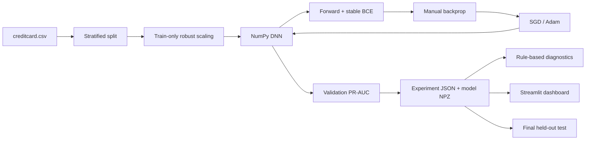

# Neural Network Failure Lab
### Build · Break · Observe · Diagnose · Fix · Explain

A reproducible **deep learning failure-analysis project** built with NumPy and evaluated on highly imbalanced credit-card fraud data. The objective is to understand how a neural network works internally, **why it fails**, and how to investigate failures—not to chase accuracy.

**Tech:** Python · NumPy · pandas · scikit-learn · Streamlit · pytest

## What is implemented?

- Fully connected binary-classification DNN implemented **without PyTorch, TensorFlow, or autograd**
- Configurable hidden layers; sigmoid, tanh, ReLU, and Leaky ReLU activations
- Stable binary cross-entropy with optional positive-class weighting
- Manual backpropagation and finite-difference gradient checking
- SGD and Adam optimizers; He, Xavier, and zero initialization
- Training history and checkpoint selection based on **validation PR-AUC**
- Experiments targeting vanishing gradients, overfitting, and class imbalance
- Rule-based diagnostic warnings, with evidence and suggested fixes
- Read-only Streamlit dashboard showing metrics and training curves
- Automated unit tests, repeatable seeds, and a held-out final test command

> **Status:** Runnable MVP. Full-dataset DNN metrics and figures have not yet been published. Diagnostic rules are heuristics, not proofs of causation. Some failure presets change multiple factors; for causal conclusions, run one-variable-at-a-time ablations.

## Dataset

[Kaggle Credit Card Fraud Detection](https://www.kaggle.com/datasets/mlg-ulb/creditcardfraud): **284,807 transactions**, approximately **0.173% fraud**. Download `creditcard.csv` separately and put it in the project root. The dataset is intentionally excluded from Git.

Preprocessing: convert `Time` to cyclical `hour_sin`/`hour_cos`, remove `Time`, stratified **70/15/15 split before scaling**, then fit `RobustScaler` **only on training data**. The notebook and loader use **31 input features**, including both scaled cyclical features. Dataset row counts: train **199,364**, validation **42,721**, test **42,722**.

The recorded Phase 1 logistic-regression validation baseline (class-weight balanced) was: precision **0.0618**, recall **0.8649**, F1 **0.1154**, PR-AUC **0.6218**. Re-running the CLI baseline may produce slightly different numbers based on the exact preprocessing and seed.

## Architecture



Default network: **31 → 16 → 8 → 1**. For batch size `m`, weights in the first layer have shape `(31,16)`, so `(m,31) @ (31,16) + (1,16) → (m,16)`. Hidden layers use ReLU in the default experiment, and the output uses sigmoid for fraud probability.

## Installation

Requires Python 3.10+.

```bash
git clone https://github.com/BhavyaSingla40/neural-network-failure-lab.git
cd neural-network-failure-lab
python -m venv .venv
# Windows PowerShell:
.venv\Scripts\Activate.ps1
# macOS / Linux:
# source .venv/bin/activate
pip install -r requirements.txt
```

Place `creditcard.csv` in the repository root.

## Run experiments

```bash
python run_experiment.py --experiment baseline
python run_experiment.py --experiment gradient_check
python run_experiment.py --experiment healthy
python run_experiment.py --experiment vanishing
python run_experiment.py --experiment overfit
python run_experiment.py --experiment imbalance
python run_experiment.py --experiment imbalance_fix
```

The CLI also supports `--csv PATH`, `--seed NUMBER`, and `--epochs NUMBER`.

| Experiment | What it probes |
| --- | --- |
| `baseline` | Balanced logistic-regression benchmark |
| `gradient_check` | Numerical vs analytical gradients |
| `healthy` | ReLU / He / Adam reference |
| `vanishing` | Deep sigmoid / SGD gradient attenuation |
| `overfit` | Larger network trained on a small stratified subset |
| `imbalance` | Unweighted fraud classification |
| `imbalance_fix` | Weighted BCE (`pos_weight=200`) |

Experiments save configuration, validation scores, epoch history, diagnostic notes and model checkpoints to `results/` (ignored by Git). Training chooses its best epoch by validation PR-AUC; it does **not** tune on test labels.

### Dashboard and tests

```bash
streamlit run dashboard.py
pytest -q
```

The dashboard reads recorded results without training. Compare PR-AUC, precision, recall, F1, ROC-AUC, confusion matrices, losses, and logged gradient norms. Run at least one experiment to populate it.

### Final test (once only)

After selecting the model and threshold using **validation data only**:

```bash
python final_evaluate.py --experiment healthy --threshold 0.5 --confirm-final
```

The final evaluator reloads the held-out test partition and produces `results/final_test.json`. Do not choose a model or threshold from this final test output.

## Why accuracy is misleading

With ~0.173% fraud, a classifier predicting every transaction as legitimate achieves ~99.83% accuracy and **zero fraud recall**. **PR-AUC** is the primary metric; we also report precision, recall, F1, ROC-AUC and confusion matrices. ROC-AUC can appear favorable even with many false positives because negatives massively outnumber positives.

## Repository layout

```text
.
├── 1.ipynb                 # Phase 1 exploration and preprocessing
├── failure_lab/
│   ├── __init__.py
│   ├── data.py             # Train/validation/test pipeline
│   ├── network.py          # NumPy network, gradients, optimizers
│   ├── train.py            # Training loop and metrics
│   └── diagnostics.py      # Failure heuristics
├── tests/test_network.py
├── run_experiment.py
├── final_evaluate.py
├── dashboard.py
├── requirements.txt
├── .gitignore
└── README.md
```

## Limitations and next steps

Current diagnostics inspect coarse gradient norms and loss gaps, and can miss failures. Some presets change multiple variables; design matched-control runs before making causal claims. Class-weighted training is not probability calibration; validation threshold selection and calibration remain future work. The next phase will add PyTorch parity, exploding/dead-ReLU/learning-rate experiments, stronger experiment logging, interpretability (SHAP/LIME), and genuine charts after full training.

**Project principle:** Build it → Break it → Observe it → Diagnose it → Fix it → Explain it.

Developed as a hands-on AI/ML engineering portfolio project.
